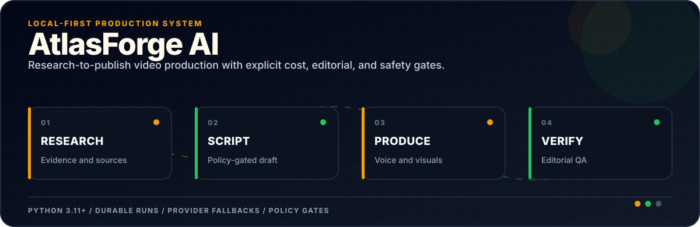
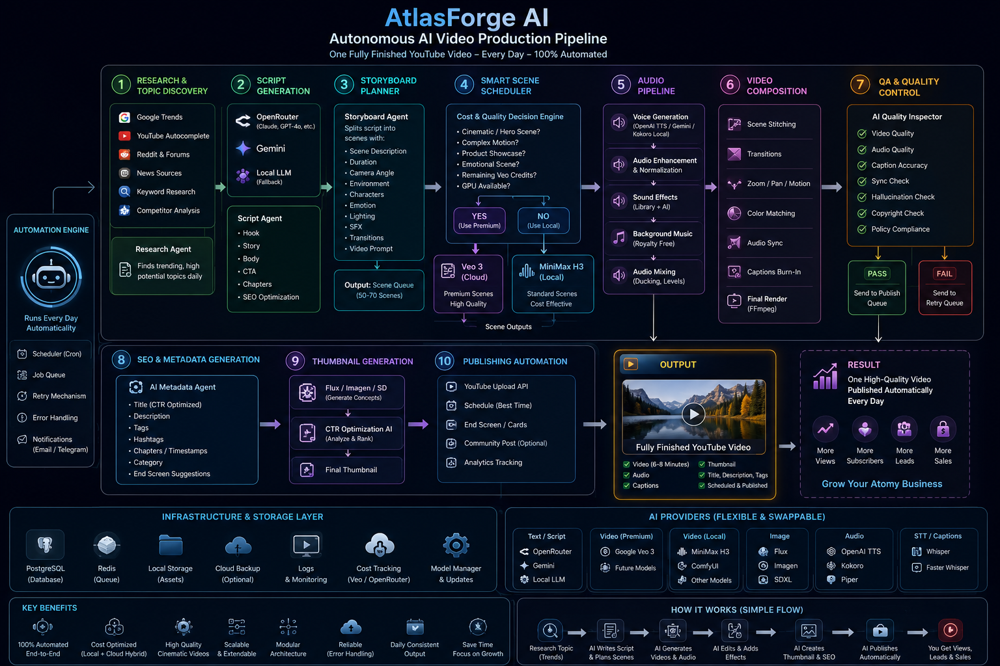

<div align="center">



</div>

**A local-first video production system with cost controls, editorial gates, and provider fallbacks.**

[](https://github.com/ReaperXD67/atlasforge-ai/actions/workflows/ci.yml)
[](pyproject.toml)
[](POLICY.md)
[](COSTS.md)

AtlasForge AI supports daily editorial production, custom cinematic music films, and reusable video
batches. Its daily pipeline researches, scripts, narrates, storyboards, edits, captions, packages,
and can optionally publish an original 6–8 minute YouTube video.

## Choose a workflow

| Workflow | What it produces | Start here |
| --- | --- | --- |
| **Editorial Studio** | Researched, narrated videos using matched real footage, owned cards, captions, and reviewable upload packages | [Windows setup](SETUP.md) |
| **Custom cinematic films · HyperFrames** | Authored full-song films with supplied photographs, generated artwork, reviewed motion inserts, deterministic camera/atmosphere movement, and measured lyric subtitles | [Cinematic workflow below](#custom-cinematic-music-films) · [reference project](videos/for-my-sweetheart/README.md) |
| **Remotion Music Film · Studio** | Song-driven racing/event edits: Remotion graphics preview, local music analysis, CLIP-ranked footage, and FFmpeg/NVENC final rendering. The Pragon profile requires licensed footage for its human and event scenes | [Racing/event workflow](docs/MUSIC_VIDEO.md) |
| **AI Viral Lab** | Individual 3–10 second vertical AI shots, with reference-led motion and optional native dialogue/audio; local Wan 2.2 on an 8 GB RTX 4070 or opt-in Gemini Omni/Veo | [AI Viral Lab](docs/VIRAL_SHORTS.md) |
| **AI Generation** | Isolated cinematic-insert candidates: a real photographic plate when possible, 1–3 seeds, and technical/vision admission checks before editorial use | [Cinematic inserts and admission](docs/VIRAL_SHORTS.md#strict-admission-policy) |
| **Shorts batches** | Resumable groups of 20–30 second HyperFrames episodes with an approved voice, aligned captions, thumbnails, upload text, and delivery checks | [Shorts batch workflow](docs/SHORTS_BATCH.md) |
| **Mixed production batches** | Flexible Shorts/full-video counts, optional fictional-story checks, segment-ID chapters, cached narration, measured reveal timing, voice-aware music, and source-checked resume | [Production batches](docs/PRODUCTION_BATCH.md) · [Repair Lab example](docs/BIZNEX_REPAIR_LAB.md) |
| **Illustrated story batches** | Original recurring characters, six room/prop/message worlds, literal speech-anchored choices, fictional-story disclosures, thumbnails and upload copy | [The Unsent Message workflow](docs/STORY_BATCH.md) |

The default editorial profiles cover education-first Atomy content for people researching online
business, side hustles, wellness, Korean skincare, and productivity. Atomy is one possible case
study, never a guaranteed income or health outcome. Editorial checks are preparation safeguards,
not predictions of views or automatic fact-checking.

Story-aware batches can lead with a broader human problem and connect Atomy as transparent context.
They require a spoken fiction disclosure and measured setup, turn, brand-context and payoff anchors;
these checks establish structural consistency, not factual endorsement, audience retention or viral reach.

The included [Unsent Message batch](docs/STORY_BATCH.md#delivery-status) has verified final exports:
three Shorts (25.1, 25.6 and 28.9 seconds) and one 5:03.6 film, with four custom thumbnails and
[complete publishing copy](videos/BIZNEX_UNSENT_STORIES_UPLOADS.md). The earlier female `af_heart`
voice is retained. These are delivered production samples, not evidence of improved audience results.

> [!CAUTION]
> AtlasForge AI automates production, not editorial responsibility. Its gates block obvious earnings promises, medical claims, early sales pitches, missing disclosures, and malformed media. You remain responsible for factual accuracy, licensing, product claims, and channel compliance.

## Custom cinematic music films

The [For my Sweetheart project](videos/for-my-sweetheart/README.md) demonstrates the authored
HyperFrames route: a complete **6:12.76 song**, **42 lyric-directed shots**, and **122 measured subtitle
cues**, delivered as a **1080p30 master** and a **720p sharing copy**. Six generated plates, the supplied
couple photograph, seeded cosmic/weather animation, and two approved Wan clips across six inserts
share one absolute song clock. The song remains the audio master.

The exported master passed a complete 11,183-frame decode, audio alignment, subtitle bounds, and
rendered-frame review. Two other motion candidates were rejected for abrupt visual changes and
flashing artifacts; their scenes use the approved image treatment. See the project's
[verified delivery notes](videos/for-my-sweetheart/README.md#verified-delivery).

To build or adapt this kind of film:

1. Follow the [project rebuild guide](videos/for-my-sweetheart/README.md#rebuild) to supply the local
   music, photographs, approved visuals, and timed lyrics. The
   [preparation script](videos/for-my-sweetheart/prepare.py) packages those inputs.
2. Author the [scene plan](videos/for-my-sweetheart/scene-plan.json), camera/caption treatment in
   [cinema.js](videos/for-my-sweetheart/cinema.js), and deterministic effects in
   [atmosphere.js](videos/for-my-sweetheart/atmosphere.js). Check and preview the project, then use
   its [Windows render script](videos/for-my-sweetheart/render.ps1).
3. Run the [delivery verifier](videos/for-my-sweetheart/verify_delivery.py) against the rendered
   master, then create a portable copy with [share.ps1](videos/for-my-sweetheart/share.ps1).

These projects live under `videos/` and are authored directly in HyperFrames. Studio's
**Remotion Music Film** workspace remains the separate racing/event workflow described above.
Private source media, generated assets, lyrics, and rendered deliveries stay local and are excluded
from Git; the repository contains the reusable composition and production tools.

## Target architecture



The diagram is the product vision. The repository implements the complete core production path, but it does **not** claim that every box in the diagram ships today. The table below is the source of truth.

| Stage | Status | What ships now | Difference from the target diagram |
| --- | --- | --- | --- |
| 1. Research and topic discovery | Implemented | Rotating Atomy editorial calendar, pinned official/regulatory source pack, Google Trends RSS, YouTube autocomplete, and Reddit audience signals | Source summaries intentionally require a periodic human refresh |
| 2. Script generation | Implemented | Gemini, OpenRouter, or local Ollama; structured hook, chapters, body, CTA, sources, and disclosure | SEO is finalized later in the metadata stage |
| 3. Storyboard planner | Implemented | Concrete shot briefs, timing, camera, environment, characters, emotion, lighting, SFX, transitions, and prompts | Defaults to 5-14 second scenes with a 48-scene cap |
| 4. Smart scene scheduler | Implemented | Routes exact facts to owned information cards, searches locally CLIP-ranked creator-diverse Pexels clips first, then considers premium or explicitly necessary local AI | Local AI remains a last resort and must pass admission |
| 5. Audio pipeline | Implemented | OpenAI TTS, Gemini TTS, local Kokoro, or local Piper; normalization, original stereo documentary score/SFX, ducking, and mixing | Provider choice is configured through fallback order |
| 6. Video composition | Implemented | Real-clip trims, subtle color matching, stable supersampled still motion, local RIFE neural interpolation, 60 fps crossfades, audio sync, script-locked captions, runtime-probed GPU encoding, and FFmpeg final render | Editorial suitability still benefits from a final human watch |
| 7. QA and quality control | Partial | Script-policy validation, media checks, deterministic synthetic-clip metrics, and an OpenRouter contact-sheet realism supervisor | Comprehensive factual and copyright scanning remain roadmap items |
| 8. SEO and metadata | Implemented | CTR-oriented title, description, tags, hashtags, chapters/timestamps, category, and disclosures | End-screen suggestions are not generated yet |
| 9. Thumbnail generation | Partial | Automatic 1280x720 local composition from a scene image and generated copy | Flux/Imagen/SD concept generation and CTR ranking are roadmap items |
| 10. Publishing automation | Implemented | One-click Studio package for the final MP4, editable title/description/tags, privacy or scheduling, custom thumbnail, timed captions, synthetic-media disclosure, browser OAuth, progress, and duplicate-safe retry | Cards, community posts, and analytics ingestion are roadmap items |

The diagram's PostgreSQL, Redis, cloud-backup, notification, and model-manager boxes are also roadmap items. The current single-workstation design uses SQLite, filesystem artifacts, structured logs, retries, checkpoints, an overlap lock, and per-run cost records. That is simpler and less expensive for one daily job; PostgreSQL and Redis become useful when the system is distributed across multiple workers. Docker profiles now provide CPU-safe, GPU-render, and fully local Ollama execution without introducing distributed infrastructure.

## Actual runtime flow

```mermaid
flowchart LR
    R["Research signals"] --> S["Script + policy gate"]
    S --> B["Deterministic storyboard"]
    B --> V["Provider-fallback narration"]
    V --> I["Matching real clips + owned cards"]
    I -->|"only if explicitly necessary"| A["Quarantined local/premium AI candidate"]
    A -->|"admission pass"| E
    I --> E["Stable 60 fps edit + original stereo sound"]
    E --> Q["Script-locked captions, thumbnail, metadata, QA"]
    Q --> P["Reviewable upload package"]
    P -->|explicit Studio click| Y["Checkpointed YouTube upload"]
    P -->|keep local| L["Upload-ready local artifacts"]
```



## Why this architecture

The target diagram proposed "MiniMax H3 running locally" as the standard-scene engine. MiniMax's supported video-generation path is its Hailuo cloud API. AtlasForge instead uses the official Wan 2.2 TI2V 5B ComfyUI workflow for a small number of local generated shots. Making every second with diffusion would still be impractically slow and visually inconsistent on an 8 GB laptop GPU, so real footage carries most of the edit.

AtlasForge AI therefore uses:

- free research signals and one structured LLM script call;
- a rotating Atomy onboarding curriculum grounded in locally pinned official U.S. and FTC sources;
- provider fallbacks for text and speech generation;
- unique Pexels Video b-roll chosen from concrete action-oriented shot briefs and locally reranked from thumbnail content with OpenAI CLIP;
- Wan 2.2 TI2V 5B only for an explicitly necessary shot, generated best-of-N and rejected when its
  geometry, physics, continuity, exposure, sharpness, or reference fidelity fails admission;
- project-owned information cards and rock-steady supersampled still motion as fallbacks;
- Whisper timing anchored to the exact approved script, so brand spelling never comes from ASR;
- a locally synthesized stereo documentary score, scene accents, sidechain ducking, and transition SFX;
- only the configured number of premium Veo or MiniMax clips, behind a hard daily USD budget;
- checkpointed artifacts and SQLite state so failed runs resume instead of restarting.

## Run artifacts

Every run is self-contained:

```text
output/YYYY-MM-DD-run-id/
|-- research/       topic candidates and source notes
|-- scripts/        structured script and narration text
|-- storyboards/    original and voice-retimed scene plans
|-- audio/          provider chunks, normalized voice, final mix
|-- scenes/         source images, owned cards, and license/provenance records
|-- videos/         Pexels clips, local-AI shots, normalized scenes, and optional premium clips
|-- music/          locally generated original music
|-- sfx/            locally generated transition effects
|-- subtitles/      SRT, animated ASS, timing JSON
|-- thumbnails/     1280x720 thumbnail
|-- metadata/       title, description, tags, chapters, QA report
|                   and duplicate-safe YouTube publish receipt
|-- final/          upload-ready MP4
|-- logs/           structured JSON logs
`-- manifest.json   status, costs, warnings, output locations
```

## Quick start

The lowest-effort path on Windows uses Docker Desktop, your OpenRouter key, free local Kokoro
narration, script-locked Whisper timing, Pexels stock video, and the RTX 4070 for 1080p60 NVENC.
Publishing and paid video generation stay off.

```powershell
git clone https://github.com/ReaperXD67/atlasforge-ai.git
Set-Location atlasforge-ai
Copy-Item .env.example .env
notepad .env # paste OPENROUTER_API_KEY; PEXELS_API_KEY is recommended
.\scripts\start_studio.ps1
```

For the optional quarantined AI Generation workspace, run this once before starting Studio. It installs
an isolated CUDA ComfyUI runtime plus Wan 2.2 TI2V 5B, SDXL 1.0 first-frame generation, and RIFE
4.26 neural frame interpolation under
`%LOCALAPPDATA%\AtlasForge\ComfyUI`:

```powershell
.\scripts\install_comfyui_wan22.ps1
```

After installation, `start_studio.ps1` starts the local video API automatically. Editorial films do
not depend on it: real clips and owned fallbacks continue to work if Wan is disabled, busy, rejected,
or unavailable.

Open `http://127.0.0.1:8741`, select **Atomy USA — Fast Preview** for the first run, and click
**Generate film**. Stop the service later with `.\scripts\stop_studio.ps1`. The first build installs
the local voice/caption stack; the first generation can also download model data into `models/`.

### Shorts delivery gate

Before a portrait Short is handed off, verify the rendered MP4, thumbnail, metadata, and voice lock
together. The gate requires a 1080x1920, 30 fps H.264/yuv420p, 20–30 second video with 48 kHz stereo
AAC audio, a non-empty 1080x1920 thumbnail, a valid title/description/hashtag package, and (when
requested) the exact approved narration voice:

```powershell
.\.venv\Scripts\atlasforge.exe verify-shorts-delivery `
  --video videos\my-short\renders\final.mp4 `
  --thumbnail videos\my-short\assets\thumbnails\thumbnail.png `
  --upload-package videos\my-short\UPLOAD_PACKAGE.md `
  --voice-manifest videos\my-short\audio_request.json `
  --expected-voice af_heart
```

`scripts/render_hyperframes_windows.ps1` can run the same gate immediately after rendering with
`-VerifyShorts -Thumbnail <path> -UploadPackage <path> -VoiceManifest <path> -ExpectedVoice <id>`,
preventing a finished MP4 from being delivered without its custom thumbnail, upload copy, approved
voice, or correct encoding.

The standalone gate defaults to 20–30 seconds. Mixed production manifests can explicitly set other
bounds; the current story batch allows 20–35-second Shorts. Narration must actually fit the declared
window—preparation rejects out-of-range audio rather than padding or speeding it up.

### Long-form YouTube delivery gate

Long-form exports use the same fail-closed handoff. The verifier requires a 1920x1080,
30 fps H.264 MP4 with 48 kHz stereo AAC audio, a 16:9 PNG/JPEG thumbnail at least
1280 pixels wide, and a complete upload package containing a valid title, description,
at least three hashtags, and timestamped chapters:

```powershell
.\.venv\Scripts\atlasforge.exe verify-youtube-delivery `
  --video videos\my-video\renders\final.mp4 `
  --thumbnail videos\my-video\assets\thumbnails\thumbnail.png `
  --upload-package videos\my-video\UPLOAD_PACKAGE.md
```

On Windows, `scripts/render_hyperframes_windows.ps1` now supports `-CheckFirst` to run
the browser audit through the stable software-Chrome fallback before encoding. Add
`-VerifyYouTube -Thumbnail <path> -UploadPackage <path> -MinDuration 300 -MaxDuration 360`
to validate the complete handoff immediately after render. The wrapper reads the project's
`authoringSkill` instead of incorrectly stamping every render as a faceless explainer.

### One-click YouTube upload

The finished render exposes an **Upload all** action in Studio. It assembles and previews the final
MP4, title, description, tags, thumbnail, timed caption track, quality result, visibility, schedule,
and synthetic-media disclosure before anything leaves the laptop. The default is **Private**.

YouTube requires one unavoidable account setup before the first click:

1. In [Google Cloud Console](https://console.cloud.google.com/), create or select a project and enable
   **YouTube Data API v3**.
2. Configure the OAuth consent screen, then create an OAuth client with application type
   **Desktop app**. Download its JSON file.
3. Create the local `secrets` folder if it is absent and save the file exactly as
   `secrets/youtube_client_secret.json`. Do not paste a YouTube API key into `.env`; uploads require
   OAuth permission to your channel.
4. Restart Studio, open a completed render, click **Upload all**, then **Authorize**. Google opens once
   in the browser and the refresh token stays locally under `output/.studio/youtube_token.json` in
   Docker mode.
5. Review the package, keep **Private** for the first upload, and click **Upload complete package**.
   AtlasForge uploads the video, metadata, thumbnail, and captions as one visible job.

Each successful stage writes `metadata/youtube_publish.json`. If the network, thumbnail, or caption
step fails after the main MP4 upload, **Resume / sync package** continues from that receipt and reuses
the existing YouTube video ID. It does not upload a duplicate. Changing metadata after the MP4 exists
updates the existing video. Scheduling is accepted only for a future time with Private visibility;
Public requires an explicit review checkbox.

Google restricts uploads from some unverified API projects to Private. That is a YouTube project
policy, not an AtlasForge failure; use YouTube Studio or complete Google's API audit when broader
visibility is required. The final human work is therefore limited to the one-time OAuth-client setup,
the Google consent click, and deciding when a reviewed Private upload should become visible.

For a native Python installation instead:

```powershell
git clone https://github.com/ReaperXD67/atlasforge-ai.git
Set-Location atlasforge-ai
Set-ExecutionPolicy -Scope Process Bypass
.\scripts\install.ps1
Copy-Item .env.example .env
notepad .env
.\.venv\Scripts\atlasforge.exe doctor
.\.venv\Scripts\atlasforge.exe run --no-upload
```

The installer does not create API credentials or enable billing. Complete [SETUP.md](SETUP.md) before the first production run.

For all container modes and diagnostics, see [Local and Docker operation](docs/LOCAL_DOCKER.md).

## Commands

```powershell
atlasforge doctor                         # no API calls or credit usage
atlasforge run --no-upload                # build today's package, do not upload
atlasforge run --topic "A realistic side hustle framework"
atlasforge youtube-auth                   # one-time browser OAuth
atlasforge run --upload                   # package and upload/schedule
atlasforge schedule                       # persistent daily scheduler
atlasforge dashboard --port 8741          # local progress UI
atlasforge music-film --track song.mp3 --title "Sepang Track Experience" --seconds 60
atlasforge viral-film --recipe beat_creature --concept "A cat dances in a pit garage" --provider local_wan --reference cat.png --track song.mp3 --seconds 5
atlasforge viral-film --recipe cinematic_insert --concept "An unbranded GT car stays parked while light rain moves" --provider local_wan --seconds 5 --candidates 2
```

The Studio adds reusable use-case profiles, editable scenes, a multitrack timeline, live provider
readiness, generation logs, cancel controls, direct playback of completed local renders, and a
reviewable one-click YouTube package with browser authorization and resumable progress.

The former `dailyvideo` command remains available as a backward-compatible alias. For unattended Windows operation, run `scripts/register_task.ps1` after a successful dry run.

## Safety defaults

- Automatic YouTube publishing is disabled.
- A render never auto-publishes; upload starts only from an explicit Studio or CLI action.
- Premium video generation is disabled.
- Upload privacy is `private`.
- Realistic synthetic media is declared through `status.containsSyntheticMedia`.
- API keys and OAuth tokens live in ignored local files.
- Private media, model weights and regenerable caches stay out of Git. Explicitly approved public
  batch assets and final deliveries may be versioned; private cinematic source media remain local.
- One SQLite lock prevents overlapping daily runs.
- A failed provider falls through; a failed compliance or media-quality gate stops publishing.
- A rejected synthetic clip remains inspectable in its run folder but is not admitted to editorial.
- YouTube accessory-stage retries reuse the checkpointed video ID instead of creating a duplicate.

## Documentation

- [Fresh Windows setup](SETUP.md)
- [Architecture and extension points](ARCHITECTURE.md)
- [Cost model](COSTS.md)
- [Custom cinematic music film: project, rebuild, and delivery checks](videos/for-my-sweetheart/README.md)
- [Remotion racing/event music films](docs/MUSIC_VIDEO.md)
- [AI Viral Lab](docs/VIRAL_SHORTS.md)
- [Shorts batches](docs/SHORTS_BATCH.md)
- [Mixed production batches](docs/PRODUCTION_BATCH.md)
- [Story-first illustrated batches and rebuild commands](docs/STORY_BATCH.md)
- [YouTube and claims policy](POLICY.md)
- [Contributing](CONTRIBUTING.md)

## Official references

The implementation follows the official documentation for [Pexels API](https://www.pexels.com/api/documentation/), [OpenAI CLIP](https://github.com/openai/CLIP), [VBench](https://github.com/Vchitect/VBench), [DOVER](https://github.com/VQAssessment/DOVER), [SDXL 1.0](https://github.com/Stability-AI/generative-models), [ComfyUI image upscaling and enhancement](https://docs.comfy.org/tutorials/utility/image-upscale), [ComfyUI Wan 2.2](https://docs.comfy.org/tutorials/video/wan/wan2_2), [Wan 2.2](https://github.com/Wan-Video/Wan2.2), [RIFE](https://github.com/hzwer/ECCV2022-RIFE), [faster-whisper](https://github.com/SYSTRAN/faster-whisper), [OpenRouter chat completions](https://openrouter.ai/docs/api/api-reference/chat/send-chat-completion-request), [OpenAI text-to-speech](https://developers.openai.com/api/docs/guides/text-to-speech), [Gemini TTS](https://ai.google.dev/gemini-api/docs/speech-generation), [Gemini Omni video](https://ai.google.dev/gemini-api/docs/omni), [Veo video generation](https://ai.google.dev/gemini-api/docs/veo), [MiniMax video generation](https://platform.minimax.io/docs/guides/video-generation), [YouTube video resources](https://developers.google.com/youtube/v3/docs/videos), [resumable uploads](https://developers.google.com/youtube/v3/guides/using_resumable_upload_protocol), [caption uploads](https://developers.google.com/youtube/v3/docs/captions/insert), [desktop browser OAuth](https://developers.google.com/identity/protocols/oauth2/native-app), and [YouTube altered/synthetic content disclosure](https://support.google.com/youtube/answer/14328491).

## License

MIT. Atomy is a trademark of its respective owner. This project is independent and is not endorsed by or affiliated with Atomy.
