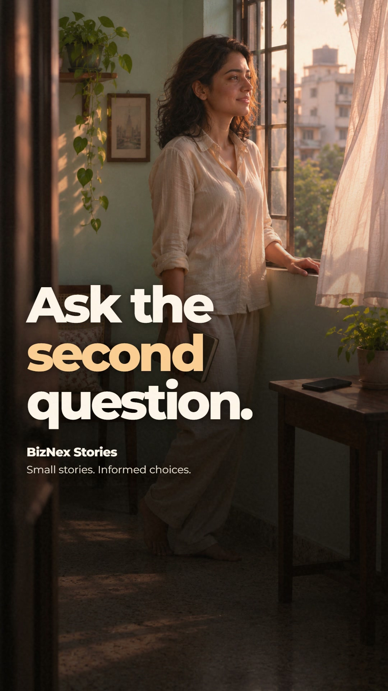

# The Second Question

An original BizNex fictional short about the moment before signing up. Mira wants a fresh start;
she pauses to understand what she needs, what it costs and what she is agreeing to.

## Delivered film

The complete **40.767-second film** is rendered at **1080 × 1920, 30 fps** with H.264 video and
stereo 48 kHz AAC audio. All **1,223 video frames** and the complete audio stream decode successfully.
The export has 18 speech-anchored shots, original night/morning photography, two local Wan
character-performance clips, editable phone interfaces, aligned captions, a licensed score,
rain ambience and interface Foley.
The [actual export review](REVIEW.md) records the frame, audio and transcript checks and their limits.

The new CosyVoice3 performance uses the familiar synthetic Kokoro `af_heart` reference and
instructions for soft, uncertain, curious and reassuring delivery. All 14 selected takes match
the 87-word script in independent ASR; two pronunciation takes were repaired before assembly.
The [voice evidence](VOICE_DELIVERY.json) and [model/runtime details](../../docs/EXPRESSIVE_VOICE.md)
describe what was actually run. The separate 31.85-second audition plays each line neutral,
then directed. ASR does not establish subjective voice preference or ElevenLabs equivalence.

[Watch or download the film](https://github.com/ReaperXD67/atlasforge-ai/releases/download/biznex-cinematic-2026-11-06/final.mp4) ·
[Complete delivery and prepared source ZIP](https://github.com/ReaperXD67/atlasforge-ai/releases/download/biznex-cinematic-2026-11-06/biznex-second-question.zip)



The previous five social follow-ups remain held and the daily operator is paused. This replacement
is delivered for viewing and reuse; it has not been posted to the three social platforms. No audience
lift has been measured. The two motion inserts originate at 384 × 672 and are visibly softer than
the still photography; they are character performances, not lip-synced speech.

## Rebuild from prepared assets

For the portable release, start with `sources/REBUILD.md` inside the extracted ZIP. It creates the
minimal environment and sets `PYTHONPATH`; no media or voice regeneration is required. The minimal
bundle includes the compiler, mixer, builder and renderer, but not the repository's packaging,
media-generation scripts or development tests.

For a full repository checkout with prepared assets restored, run these commands from its root:

```powershell
.venv/Scripts/python.exe videos/biznex-second-question/create_edit.py
.venv/Scripts/python.exe scripts/run_cinematic_project.py videos/biznex-second-question
.venv/Scripts/python.exe scripts/run_cinematic_project.py videos/biznex-second-question --check-only
.venv/Scripts/python.exe scripts/run_cinematic_project.py videos/biznex-second-question --render
.venv/Scripts/python.exe scripts/package_cinematic_delivery.py --check --project-source
.venv/Scripts/python.exe scripts/package_cinematic_delivery.py --project-source
```

`create_edit.py` selects the canonical expressive narration and measured `timing.json` by default.
The optional `--baseline` is for the retained development audio, which is not included in the portable
release. The renderer refuses stale edit or audio receipts. The packager refuses an existing export;
preserve earlier deliveries before packaging a revision. See the
[full workflow](../../docs/CINEMATIC_PROJECT_WORKFLOW.md) and
[portable export guide](../../docs/CINEMATIC_DELIVERY.md) for prerequisites and verification limits.

Large generated media and model weights are outside Git; the release ZIP includes prepared media
and the small runtime sources needed to rebuild, with its own `sources/REBUILD.md`. Original plates are
listed in `VISUAL_PROVENANCE.json`; motion seeds, prompts and media hashes are in
[MOTION_PROVENANCE.json](MOTION_PROVENANCE.json). Voice runtime installation and pinned weights are
documented in [expressive voice](../../docs/EXPRESSIVE_VOICE.md). Restore prepared assets before
running the edit compiler: it fails rather than substituting generic stock footage or silence.

The following optional media-regeneration commands require the **full repository** and separate
model/runtime setup; they are not part of the prepared bundle rebuild:

```powershell
# Existing cached ComfyUI and Wan models; run one GPU workload at a time.
.venv/Scripts/python.exe scripts/generate_cinematic_motion.py --help
.venv/Scripts/python.exe scripts/prepare_cinematic_foley.py
```

Creative decisions are in [BRIEF.md](BRIEF.md), [STORYLINES.md](STORYLINES.md), and
[SPEC.md](SPEC.md). `EDIT_PLAN.json` contains speech anchors; `DIRECTION.json` controls visual
presentation. `AUDIO_MIX.json` records measurements, not a subjective listening approval.

## Sources and credits

The character and her story are fictional. Photographs and performance clips are generated;
the voice is synthetic. Phone signup/note screens are original editorial illustrations, not
an official Atomy interface or testimonial. The [Atomy India registration guide](https://in.atomy.com/cst/userGuide/25100000002321)
is the source-reading destination; requirements differ by country and can change.

Music: **“Hiraeth” by Scott Buckley**, licensed under **CC BY 4.0**.
[Track and attribution](https://www.scottbuckley.com.au/library/hiraeth/) ·
[License](https://creativecommons.org/licenses/by/4.0/).
The edit excerpts, fades and ducks the recording. Include this credit in each published description.

Foley: Kenney Interface Sounds; rain: Ylmir field recording, both CC0. Original URLs, hashes and
declared transformations are in [the audio provenance](assets/audio/FOLEY_PROVENANCE.json).
The camera/match-cut primitives retain [HyperFrames Apache-2.0 attribution](../../docs/licenses/HYPERFRAMES-APACHE-2.0.txt).
Montserrat is under its [SIL Open Font License](assets/fonts/Montserrat-OFL.txt).
