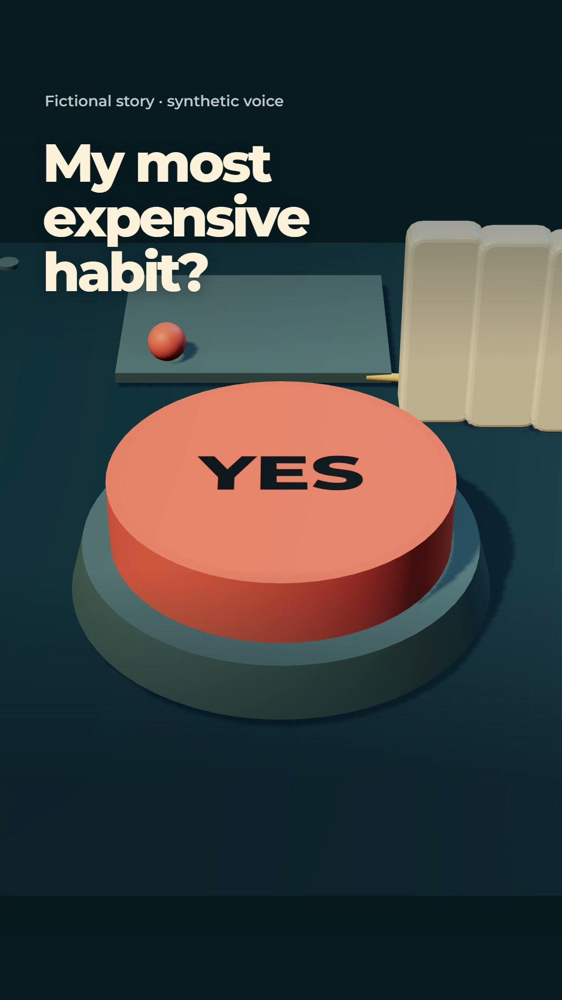

# The Yes Machine

**One little yes can start a whole machine. Three questions can stop it.**

A 26.3-second fictional BizNex story built from an original mechanical 3D world,
five complete narrated thoughts and word-anchored editing. No image or video
model creates its visuals. The preceding *Second Question* film stays unchanged.

The coral YES button sets off a chain of consequences: money, time and unused
goods. A deliberate pause interrupts it. Three physical gates lead to two valid
choices—YES and NOT NOW. The story is educational context for an independent
Atomy community, with visible fictional/synthetic disclosure.

<p align="center"><a href="https://github.com/ReaperXD67/atlasforge-ai/releases/tag/biznex-yes-machine-2026-11-06"></a><br><a href="https://github.com/ReaperXD67/atlasforge-ai/releases/download/biznex-yes-machine-2026-11-06/final.mp4">Watch the film with sound</a> · <a href="https://github.com/ReaperXD67/atlasforge-ai/releases/download/biznex-yes-machine-2026-11-06/biznex-the-yes-machine.zip">Download film and prepared sources</a></p>

## Run the production recipe

From the repository root, after the setup in [the pipeline guide](../../docs/NEXT_STORY_PIPELINE.md):

```powershell
.venv/Scripts/python.exe scripts/run_story_pipeline.py videos/biznex-the-yes-machine
.venv/Scripts/python.exe scripts/run_story_pipeline.py videos/biznex-the-yes-machine --execute
.venv/Scripts/python.exe scripts/run_story_pipeline.py videos/biznex-the-yes-machine --execute --resume
```

The first command prints the ten stages. Execution prepares or verifies the voice,
authors the measured shot plan, synthesizes score/Foley, compiles timing, mixes,
builds, renders, checks encoded speech, extracts review frames and packages the film.
Resume requires matching inputs, code, runtime and output hashes, including every
review image. A changed file cannot silently inherit a successful receipt.

The checked-in source omits WAV/MP4 outputs and local model weights. A prepared
source delivery includes the necessary media for rebuilding the film without
rerunning speech inference. Fresh voice generation requires the separately installed
[pinned CosyVoice environment](https://github.com/ReaperXD67/atlasforge-ai/blob/main/docs/EXPRESSIVE_VOICE.md).

## What drives the film

| Input | Purpose |
| --- | --- |
| [BRIEF.md](BRIEF.md), [BRAG plan](brag-plan.md) | Hook, story, tone, visual constraints and reading discipline |
| [script.txt](script.txt), [VOICE_PLAN.json](VOICE_PLAN.json) | Exact words and five thought-level performance directions |
| [assets/world.json](assets/world.json) | Original geometry, material palette and light recipe |
| [PIPELINE.json](PIPELINE.json) | Explicit local production stages and their file dependencies |
| [prepare_yes_machine.py](../../scripts/prepare_yes_machine.py) | Authored shot meanings, spoken anchors, caption policy and sound-layer roles |
| [EDIT_PLAN.json](EDIT_PLAN.json), [DIRECTION.json](DIRECTION.json) | Compilable editorial plan and deterministic scene modes |

The story, voice direction and visual meaning remain authored inputs. The pipeline
automates their production and verification; it does not independently prove a
good hook or natural acting. Reuse the generic runner with another reviewed recipe;
this machine's specific choreography is not a universal text-to-video generator.

## Performance and delivery evidence

The source narration is 26.270 seconds, 54 words in five complete thoughts. All five
selected takes pass independent transcript checks; the frame-aligned plan has 789
frames at 30 fps and 13 shots. The measured model session took 78.759 seconds,
excluding process preflight/imports and CPU ASR. Emotion fidelity and exact speaker
similarity are not established by transcript matching.

The delivered MP4 is **1080 × 1920, 30 fps H.264 / stereo AAC**, with all **789 frames**
decoded. Its encoded narration passes **5/5** thought checks, measures **−16.01 LUFS /
−3.42 dBTP**, and has zero measured lag against the master. The revised mix makes the
score and mechanical accents more audible while preserving the original narration.

The actual ten-stage run completed in **365.424 seconds**, including **326.019 seconds**
for the software-browser gate, render and decode. It reused the newly generated,
hash-verified narration; the model-session time above is separate. These are local
measurements, not universal speed promises. [Production metrics](PRODUCTION_METRICS.json)
record each stage and the toolchain.

All **10 contact sheets / 78 unique decoded frames** were inspected. The final sound
revision has the identical encoded visual stream and identical sampled pixels; its
bookends and representative sheet were inspected again. No blocking visual defect
was found in those samples. A minor remaining detail is that gate bars briefly cross
behind question headings without hiding the words. This is sampled visual review,
not a continuous playback or listening-panel approval.

See [voice evidence](VOICE_DELIVERY.json), [mix](AUDIO_MIX.json),
[render receipt](STORY_RENDER.json), [encoded audio](https://github.com/ReaperXD67/atlasforge-ai/blob/main/videos/biznex-the-yes-machine/qa/audio/encoded-audio-verification.json),
[frame coverage](https://github.com/ReaperXD67/atlasforge-ai/blob/main/videos/biznex-the-yes-machine/qa/frames/frame-review.json), [review scope](DELIVERY_REVIEW.json) and
[archive identity](https://github.com/ReaperXD67/atlasforge-ai/blob/main/videos/biznex-the-yes-machine/STORY_PACKAGE.json). The technical checks do not establish human
indistinguishability or audience reach.

[Publishing copy](UPLOAD_COPY.md) · [Credits](CREDITS.md) · [Visual research](https://github.com/ReaperXD67/atlasforge-ai/blob/main/docs/NEXT_FILM_VISUAL_TOOLS.md)
· [Voice lab](https://github.com/ReaperXD67/atlasforge-ai/blob/main/docs/NEXT_VOICE_PASS.md)

## Published edition

The exact verified film was published on **7 November 2026**:

- [YouTube Short](https://www.youtube.com/shorts/Dc4aBDQfQ9w) — public and fully processed; all 16 uploaded caption cues match the source.
- [Instagram reel](https://www.instagram.com/p/Dfch-tjKvp7/) — published to `@biznex.stories`, with its AI content label.
- [Facebook reel](https://www.facebook.com/reel/1759901191770877) — public on BizNex, with its AI content label.

Production and publishing remain separate stages. The daily local operator is active
at 09:00 Asia/Calcutta and records each destination to prevent duplicate uploads.
The five rejected earlier pilot follow-ups remain held. Private publication evidence
stays outside Git; the public posts above are the delivery references.
